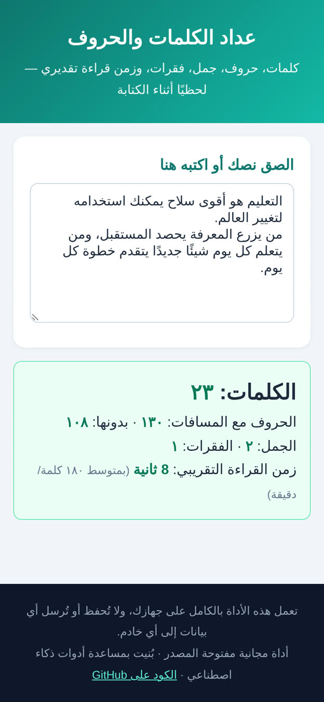

# Word & Character Counter | عداد الكلمات والحروف

Count words, characters, sentences and paragraphs in Arabic or English text, with an estimated reading time. Arabic interface.

**Live app:** https://abood-ayman.github.io/word-counter-ar/

This is a personal project, built with AI tools.

## Features
- Live counts: words, characters (with and without spaces), sentences, paragraphs
- Supports Arabic, English and mixed text
- Reading-time estimate at 180 words per minute
- Text never leaves your device: useful for papers, articles and word limits

## Privacy
Everything runs in your browser. No data is stored or sent anywhere.

## Run locally
Open `index.html` in any browser. It is a single static page with no dependencies.

## Status
Stable.

## Copyright
MIT License - Copyright (c) 2026 Abdullah Ayman.
